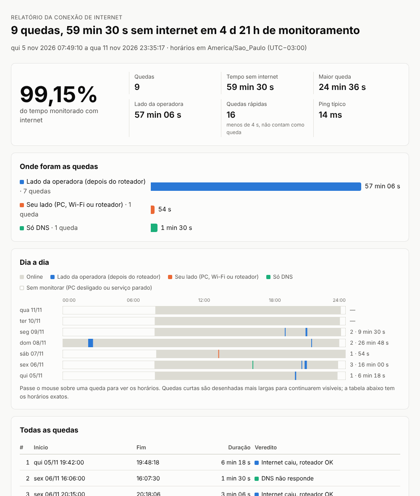

<p align="center"></p>

<h1 align="center">OutageLog para Linux</h1>

<p align="center"><b>Registra cada queda de internet no Linux e gera um relatório que mostra se o problema foi na sua rede ou na operadora.</b></p>

<p align="center"><a href="README.md">🇺🇸 Read in English</a></p>

Sua internet cai toda hora, mas quando você liga para a operadora "do lado deles está tudo normal", e a queda já passou antes de dar tempo de fazer um teste de velocidade. O que você precisa é de um registro de cada queda, com horários, e de algo que diferencie o *seu* Wi-Fi da *linha deles*.

Esta é uma versão para Linux do [OutageLog](https://github.com/BoazCohenJ/OutageLog) de BoazCohenJ, um app para Windows escrito em C#. A lógica que decide o que é queda é a mesma, e o relatório também. Ele roda como **serviço do systemd**, tem um **ícone na bandeja** que avisa quando a internet cai e não precisa de nada além do Python 3, que já vem no Linux Mint, Ubuntu, Debian e Fedora.

> Versão não oficial, sem ligação com o autor original. A interface está em **português e inglês**. Ela segue o idioma do sistema, e dá para trocar na configuração.



## Recursos

- **Diferencia os lados.** A cada rodada ele checa o seu roteador *e* três servidores de internet de empresas diferentes (Cloudflare `1.1.1.1`, Google `8.8.8.8`, Quad9 `9.9.9.9`).
  - O roteador responde e a internet não: a falha é da operadora.
  - O roteador também para de responder: é o seu Wi-Fi, o cabo ou o roteador.
  - A internet responde, mas os nomes não resolvem: é o DNS.
- **Um relatório para mandar à operadora.** Um arquivo HTML só, com:
  - a porcentagem de tempo online;
  - cada queda com início e duração;
  - uma linha do tempo por dia;
  - o ping típico e o pior;
  - a tabela de quedas para baixar em CSV.
- **Roda desde que o PC liga, antes de qualquer login.** Ele roda como serviço do systemd com isolamento: usuário próprio, só a permissão `CAP_NET_RAW` e sem acesso ao `/home`.
- **Ícone na bandeja.** Fica verde, amarelo, vermelho ou cinza, e mostra uma notificação quando a internet cai e quando volta. O menu gera relatórios com um clique.
- **Números honestos.**
  - O tempo com o PC desligado ou suspenso não entra na conta.
  - A reconexão depois de acordar não conta como queda.
  - Uma falha isolada conta à parte, como queda rápida.
- **Funciona em redes que bloqueiam ping.** Se um servidor da internet não responde a ping, ele tenta a porta TCP 443. Se o roteador não responde a ping, ele tenta as portas 80/443/53, e até um "conexão recusada" prova que o roteador está lá.
- **Teste de DNS mais confiável.** Ele consulta direto os servidores DNS da rede, sem passar pelo cache do systemd-resolved, e só conta como falha quando dois sites diferentes falham.
- **Também vigia equipamentos da rede interna** (opcional). Servidor, impressora ou switch ganham uma seção própria no relatório. Se só a impressora cai, o problema é ela.
- **Arquivos simples.** Cada checagem vira uma linha num CSV diário. **O formato é o mesmo da versão Windows**, então dá para gerar o relatório no Linux a partir de logs copiados de um PC com Windows. Nada é enviado para lugar nenhum.
- **Sem dependências.** Só usa a biblioteca padrão do Python (3.8 a 3.13). O GTK é opcional e só serve para o ícone na bandeja.

## Instalar

```sh
git clone https://github.com/LucasAmf32/outagelog-linux
cd outagelog-linux
sudo ./instalar.sh
outagelog autoteste
```

Também dá para baixar o ZIP pelo GitHub (**Code → Download ZIP**), descompactar e rodar `sudo ./instalar.sh` dentro da pasta. O `instalar.sh` é só um atalho para o `install.sh`, e os dois fazem a mesma coisa.

O instalador:

- copia o programa para `/usr/local/lib/outagelog` e cria o comando `outagelog`;
- cria o usuário de sistema `outagelog`;
- cria o `/etc/outagelog.ini`;
- liga o serviço;
- se houver GTK para Python, coloca o ícone da bandeja no menu e no início automático de cada usuário.

**Para ter a melhor prova**, use um PC ligado ao roteador por cabo. No Wi-Fi, um sinal fraco aparece como "seu lado", nunca como "lado da operadora". Então os números da operadora continuam confiáveis, mas algumas quedas reais dela podem ficar escondidas atrás das quedas do Wi-Fi.

## Usar

| Comando | O que faz |
|---|---|
| `outagelog status` | estado atual, últimas 24 h e quedas dos últimos 7 dias |
| `outagelog relatorio 7` | relatório HTML dos últimos 7 dias (`--saida arquivo.html`, `--nao-abrir`, `--utc`) |
| `outagelog ao-vivo` | mostra cada rodada na tela, sem gravar nada |
| `outagelog autoteste 20` | checagens reais mais 20 s de queda simulada; código de saída 0 = passou |
| `outagelog bandeja` | ícone na bandeja (normalmente abre sozinho no login) |
| `outagelog demo` | relatório de exemplo com dados inventados |
| `journalctl -u outagelog -f` | quedas aparecendo ao vivo no log do sistema |

Cada comando também tem nome em inglês (`report`, `live`, `self-test`, `tray`…). Com `--idioma pt|en`, um comando sai num idioma específico.

## Ícone na bandeja

Ele fica **verde** quando está online, **amarelo** quando a conexão está lenta, **vermelho** quando a internet caiu e **cinza** quando o monitoramento está parado.

- Quando a internet cai, aparece uma notificação dizendo de quem é o problema. Quando ela volta, outra notificação diz quanto tempo ficou fora. São no máximo 4 avisos a cada 10 minutos.
- O menu gera relatórios, que ficam salvos em `Documentos/OutageLog`.
- A bandeja não faz checagem nenhuma: ela só lê o log do serviço. Fechar a bandeja não para o monitoramento.
- Para ela não abrir mais no login, desmarque "OutageLog" em **Aplicativos de inicialização**.

## Como ele decide

| Roteador | Servidores da internet | DNS | Veredito | De quem é a culpa |
|---|---|---|---|---|
| qualquer | pelo menos 2 de 3 respondem rápido | funciona | **Online** | |
| qualquer | só 1 responde, ou o mais rápido passa de 300 ms | funciona | **Lenta ou instável** (não é queda) | |
| qualquer | respondem | falha | **DNS não responde** | DNS |
| responde | nenhum responde | | **Internet caiu, roteador OK** | Operadora |
| respondia antes, agora não | nenhum responde | | **Roteador não responde** | Sua |
| sem rede | | | **PC sem conexão** | Sua |
| nunca responde | nenhum responde | | **Internet caiu** | Indeterminado |

Uma **queda** começa com 2 ou mais rodadas seguidas com falha e termina com 2 rodadas boas. Uma falha isolada conta como **queda rápida**.
Os 30 segundos depois de ligar ou de voltar da suspensão não são julgados. Pausas de mais de 20 segundos entre as rodadas (suspensão, desligamento) contam como "sem monitorar".

## Configuração

Edite o `/etc/outagelog.ini` (veja um exemplo comentado com `outagelog config-exemplo`) e depois rode `sudo systemctl restart outagelog`.

```ini
[outagelog]
idioma = auto            # auto, pt ou en
intervalo_segundos = 2
manter_dias = 60         # apaga logs diários mais velhos que isso (0 = guarda tudo)

[internos]
servidor = 192.168.0.10:445   # com porta: testa abrindo uma conexão TCP
impressora = 192.168.0.50     # sem porta: testa com ping
```

As chaves podem ser escritas em português ou em inglês.

## Arquivos

- **Logs:** `/var/lib/outagelog/samples-AAAA-MM-DD.csv`, um arquivo por dia (cerca de 2 MB) e uma linha por rodada. Os arquivos com mais de 60 dias são apagados.
- **Relatórios gerados pela bandeja:** ficam em `Documentos/OutageLog`.
- **Sem o serviço:** `outagelog rodar` monitora como usuário comum e grava em `~/.local/share/outagelog`.

Para auditar o isolamento do serviço: `systemd-analyze security outagelog`.

## Desinstalar

```sh
sudo ./desinstalar.sh          # mantém os logs e a configuração
sudo ./desinstalar.sh --tudo   # apaga tudo
```

## Perguntas frequentes

**Ele deixa a internet mais lenta?**
Não. Cada rodada são 4 pings pequenos e duas consultas de DNS, menos de 1 KB, o que dá uns 1–2 MB por hora. Para checar com menos frequência, ajuste `intervalo_segundos`.

**Isso prova que a culpa foi da operadora?**
Ele dá horários e uma observação clara: às 20:31 o roteador respondeu e três servidores independentes da internet não responderam, por 11 minutos. Normalmente é isso que faz a operadora mandar um técnico olhar a linha. Mas continua sendo a visão de um PC só, então, se puder, guarde também o log do próprio modem.

**Todas as minhas quedas aparecem como "Internet caiu", sem dizer de quem foi a culpa.**
Seu roteador não responde a ping nem às portas 80/443/53, então o programa não tem como saber se a falha foi antes ou depois dele. Os horários das quedas continuam certos. O `outagelog autoteste` avisa se esse é o seu caso.

**E VPN?**
Ele checa o roteador da placa de rede física. Mesmo assim, uma VPN que cai enquanto a linha está boa também parece queda. Para gerar prova para a operadora, desligue a VPN.

**IPv6?**
Por enquanto só o IPv4 é checado.

## Desenvolvimento

```sh
python3 -m unittest discover -s testes     # 42 testes, Python 3.8–3.13
python3 -m outagelog ao-vivo               # roda direto da pasta, sem instalar
```

| Arquivo | O que faz |
|---|---|
| `modelo.py` | os vereditos e os textos |
| `classificador.py` | transforma uma rodada em veredito |
| `rastreador.py` | junta as rodadas em quedas |
| `sondas.py` | ping, TCP, DNS e rota padrão |
| `registro.py` | os CSVs |
| `relatorio.py` | os números e o HTML do relatório |
| `bandeja.py` | o ícone na bandeja e as notificações |
| `cli.py` | os comandos |
| `idioma.py` | português e inglês |

## Licença

[MIT](LICENSE). OutageLog original © 2026 BoazCohenJ. Esta versão mantém a licença e o crédito originais.
