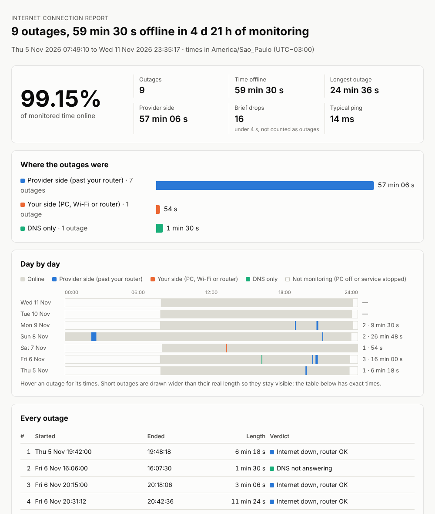

<p align="center"></p>

<h1 align="center">OutageLog for Linux</h1>

<p align="center"><b>Log every internet outage on Linux, and get a report that shows whether the problem was on your side or your provider's.</b></p>

<p align="center"><a href="LEIAME.md">🇧🇷 Leia em português</a></p>

Your internet keeps dropping, but when you call the provider everything "looks fine on our end", and the drop was over before you could run a speed test. What you need is a record of every outage, with times, and something that tells *your* Wi-Fi apart from *their* line.

This is a Linux port of [OutageLog](https://github.com/BoazCohenJ/OutageLog) by BoazCohenJ, which is a Windows app written in C#. It keeps the same outage-detection logic and the same report. It runs as a **systemd service**, has a **tray icon** that notifies you when the internet drops, and needs nothing beyond the Python 3 that already comes with Linux Mint, Ubuntu, Debian and Fedora.

> Unofficial port, not affiliated with the original author. The interface is in **English and Brazilian Portuguese**. It follows your system language, and you can change it in the settings.



## Features

- **Tells the sides apart.** Every round it checks your router *and* three internet servers run by different companies (Cloudflare `1.1.1.1`, Google `8.8.8.8`, Quad9 `9.9.9.9`).
  - Router answers but the internet doesn't: the break is on the provider's side.
  - Router stops answering too: it's your Wi-Fi, cable or router.
  - Internet answers but names don't resolve: it's DNS.
- **A report you can send.** One self-contained HTML file with:
  - the availability percentage;
  - every outage with start time and length;
  - a timeline per day;
  - typical and worst ping;
  - a CSV download of the outage table.
- **Runs from boot, before anyone logs in.** It runs as a hardened systemd service: a dedicated user, only `CAP_NET_RAW`, and no access to `/home`.
- **Tray icon.** Green, yellow, red or grey, with a notification when an outage starts and when you're back online. The menu makes reports with one click.
- **Honest numbers.**
  - Time the PC was off or asleep isn't counted.
  - Reconnecting after wake-up isn't logged as an outage.
  - Single failed checks are counted separately as brief drops.
- **Works where ping is blocked.** If an internet server doesn't answer ping, it tries TCP port 443. If the router doesn't answer ping, it tries ports 80/443/53, and even "connection refused" proves the router is there.
- **More reliable DNS check.** It asks the network's DNS servers directly, bypassing the systemd-resolved cache. It only counts as failed when two different names fail.
- **Watch local devices too** (optional). A file server, a printer or a switch get their own section in the report. If only the printer drops, you know it's the printer.
- **Plain files.** Every check is one line in a daily CSV file. **It uses the same format as the Windows version**, so you can make a report on Linux from logs copied from a Windows PC. Nothing is uploaded anywhere.
- **No dependencies.** It uses only the Python standard library (3.8 to 3.13). GTK is optional and only needed for the tray icon.

## Install

```sh
git clone https://github.com/LucasAmf32/outagelog-linux
cd outagelog-linux
sudo ./install.sh
outagelog self-test
```

Or download the ZIP from GitHub (**Code → Download ZIP**), extract it, and run `sudo ./install.sh` inside the folder.

The installer:

- copies the program to `/usr/local/lib/outagelog` and creates the `outagelog` command;
- creates an `outagelog` system user;
- writes `/etc/outagelog.ini`;
- starts the service;
- if GTK for Python is available, adds the tray icon to the menu and to every user's startup applications.

**For the best evidence**, run it on a PC connected to the router by cable. On Wi-Fi, a weak signal shows up as "your side", never as "provider side". So the provider-side numbers stay trustworthy, but some real provider outages may hide behind Wi-Fi drops.

## Usage

| Command | What it does |
|---|---|
| `outagelog status` | current state, last 24 hours, outages of the last 7 days |
| `outagelog report 7` | HTML report of the last 7 days (`--out file.html`, `--no-open`, `--utc`) |
| `outagelog live` | print every round live, log nothing |
| `outagelog self-test 20` | real checks plus a faked 20 s outage; exit code 0 = pass |
| `outagelog tray` | tray icon (normally starts by itself at login) |
| `outagelog demo` | a report made from made-up data |
| `journalctl -u outagelog -f` | watch outages appear in the system log |

Every command also has a Portuguese name (`relatorio`, `ao-vivo`, `autoteste`, `bandeja`…). `--language en|pt` overrides the language for one command.

## How it decides

| Router | Internet servers | DNS | Verdict | Side |
|---|---|---|---|---|
| any | at least 2 of 3 answer quickly | works | **Online** | |
| any | only 1 answers, or even the fastest is slower than 300 ms | works | **Slow or unstable** (not an outage) | |
| any | answer | fails | **DNS not answering** | DNS |
| answers | none answer | | **Internet down, router OK** | Provider |
| answered earlier, not now | none answer | | **Router not reachable** | Yours |
| no network connection | | | **PC not connected** | Yours |
| never answers | none answer | | **Internet down** | Undetermined |

An **outage** starts at the first of 2 or more failed rounds in a row and ends at the first of 2 good rounds. A single failed round is a **brief drop**.
Checks in the 30 seconds after monitoring starts or the PC wakes up aren't judged. Gaps longer than 20 seconds between rounds (sleep, shutdown) count as "not monitoring".

## Settings

Edit `/etc/outagelog.ini` (`outagelog example-config` prints a commented example), then run `sudo systemctl restart outagelog`.

```ini
[outagelog]
language = auto          # auto, en or pt
interval_seconds = 2
keep_days = 60           # delete daily logs older than this (0 keeps everything)

[internal]
fileserver = 192.168.0.10:445   # with a port: checked by opening a TCP connection
printer = 192.168.0.50          # without a port: checked with ping
```

The keys can be written in English or in Portuguese.

## Files

- **Logs:** `/var/lib/outagelog/samples-YYYY-MM-DD.csv`, one file per day (about 2 MB) and one line per round. Files older than 60 days are deleted.
- **Reports from the tray icon:** saved to `~/Documents/OutageLog`.
- **Without the service:** `outagelog run` monitors as a normal user and writes to `~/.local/share/outagelog`.

To audit the service sandbox: `systemd-analyze security outagelog`.

## Uninstall

```sh
sudo ./uninstall.sh          # keeps logs and settings
sudo ./uninstall.sh --all    # deletes everything
```

## FAQ

**Will it slow down my internet?**
No. A round is 4 small pings and two DNS lookups, under 1 KB, so about 1–2 MB an hour. To check less often, set `interval_seconds`.

**Does it prove the outage was my provider's fault?**
It gives you timestamps and a clear observation: at 20:31 the router answered and three independent internet servers didn't, for 11 minutes. That's usually what gets a technician to look at the line. It's still one PC's view, so keep the modem's own log alongside it if you can.

**My outages all say "Internet down" with no side.**
Your router doesn't answer ping or ports 80/443/53, so the program can't tell whether the break was before or after it. The outage times are still right. `outagelog self-test` tells you if this applies to you.

**What about VPNs?**
It checks the router of the physical network card. Still, a VPN that drops while your line is fine also looks like an outage. For evidence to show your provider, turn the VPN off.

**IPv6?**
Only IPv4 is checked for now.

## Development

```sh
python3 -m unittest discover -s testes     # 42 tests, Python 3.8–3.13
python3 -m outagelog live                  # run from the folder without installing
```

The code (identifiers and comments) is in Portuguese.

| File | What it does |
|---|---|
| `modelo.py` | verdicts and their labels |
| `classificador.py` | turns one round into a verdict |
| `rastreador.py` | folds rounds into outages |
| `sondas.py` | ping, TCP, DNS, default route |
| `registro.py` | the CSV logs |
| `relatorio.py` | report numbers and HTML |
| `bandeja.py` | tray icon and notifications |
| `cli.py` | commands |
| `idioma.py` | English/Portuguese |

## License

[MIT](LICENSE). Original OutageLog © 2026 BoazCohenJ. This port keeps the original license and credit.
